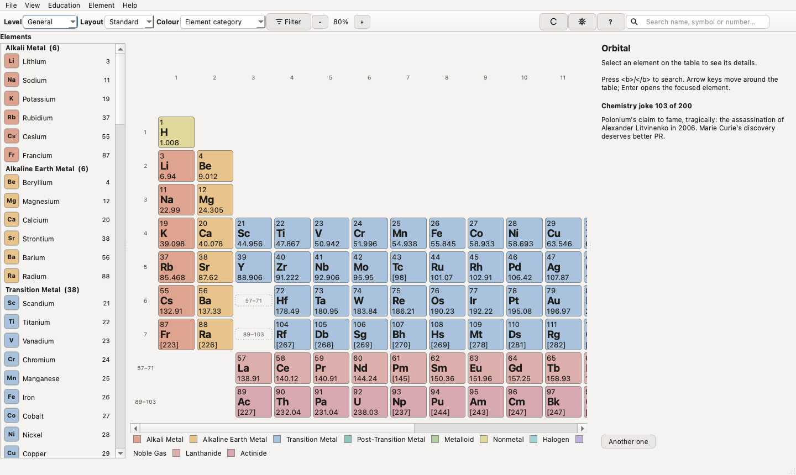
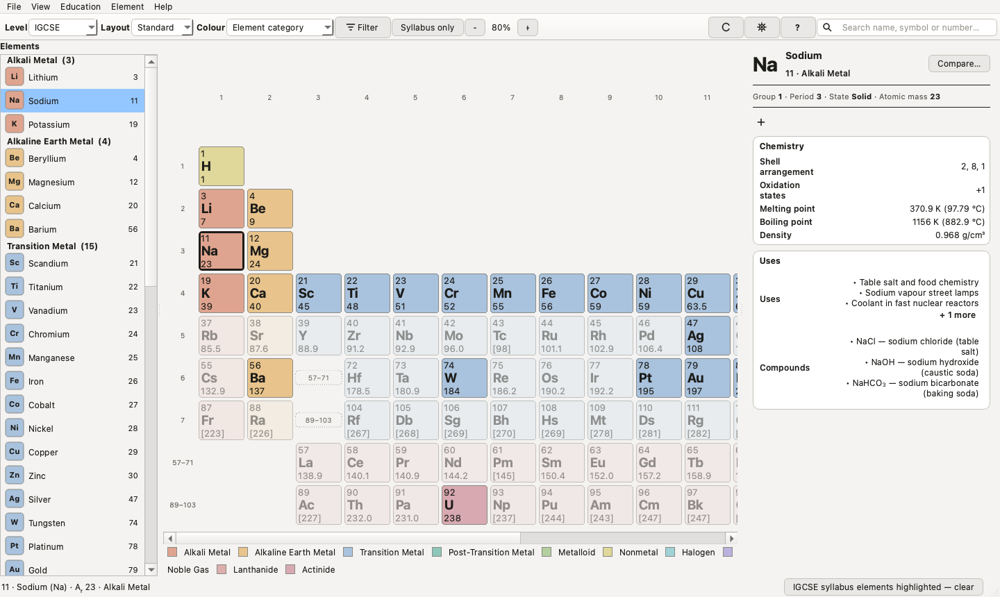
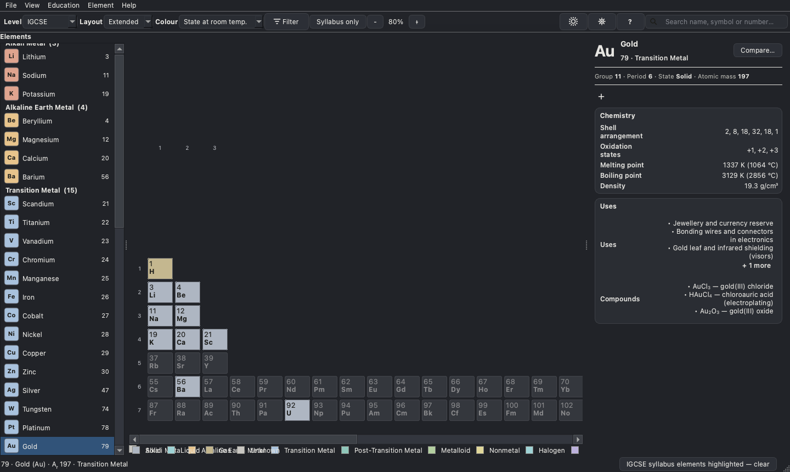
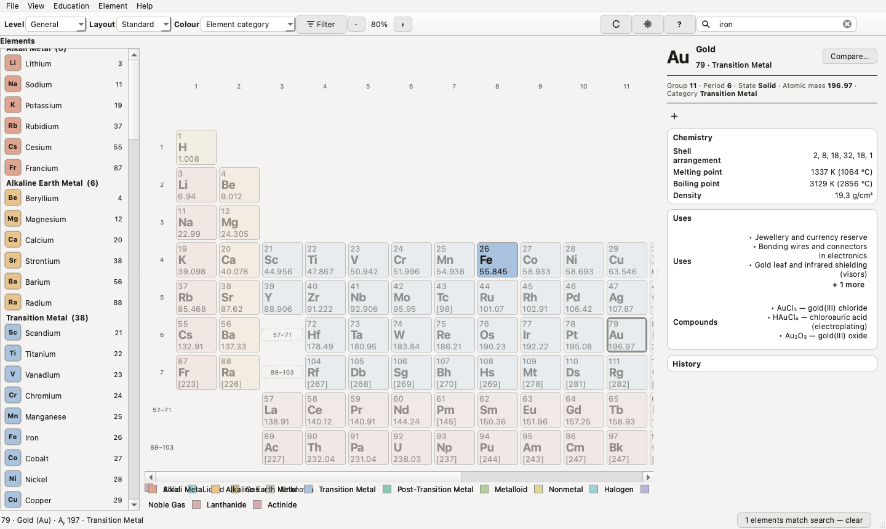
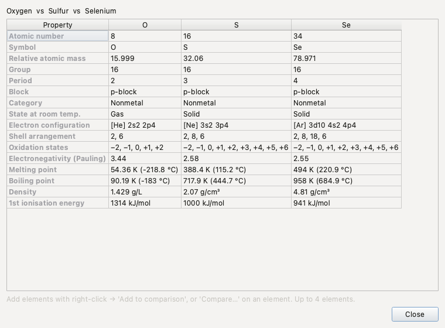

# Orbital

**A fast, offline periodic table for macOS, Windows, and Linux.** Built with Python and Qt (PySide6) — a real desktop app, not a web page in a window. All 118 elements, four table layouts, education levels from IGCSE to Advanced, fifteen ways to colour the table, and 200 chemistry jokes.

The complete feature list lives in [FEATURES.md](FEATURES.md).

No account, no cloud, no telemetry. The table loads instantly because everything is on disk.

<p align="center">
  
</p>
<p align="center"><em>First launch. The table is the interface — the sidebar groups elements
into families like a GarageBand instrument browser, and until you pick an element,
the right panel rotates through a curated set of 200 chemistry jokes (deterministic
per day, shuffle button included).</em></p>

## Why this exists

Every periodic table app I've used is either a website pretending to be software, or a desktop app that buries the table under dashboards, 3D atom viewers, and onboarding tours. I wanted the opposite: something I'd actually keep open next to my chemistry homework. Small outside, deep underneath — the table dominates, everything else gets out of the way.

It also respects the fact that a Year 10 student and a first-year university student need different things from the same 118 elements. The database is complete; the education level controls what you see by default.

## Features

- **118 elements**, complete dataset, one JSON file per element (atomic weights IUPAC 2021, configurations NIST, see [docs/data-sources.md](docs/data-sources.md))
- **Search** by name, symbol, or atomic number — instant, prefix-ranked (`o` → Oxygen), and category queries work too (`noble gases`, `radioactive`, `alkali metals`…)
- **Filters** — category, state, block, natural/synthetic, radioactive, discovery year — with a live count and one-click clear
- **Quick comparison** — right-click → *Add to comparison*, up to 4 elements side by side
- **Education levels** — General / IGCSE / A Level / Advanced (see below)
- **4 table layouts** — Standard, Compact, Extended (32-column), School
- **15 colour modes** — category, block, state, group, period, mass, melting/boiling point, electronegativity, density, ionisation energy, discovery era, natural/synthetic, radioactive, monochrome — with a legend that always explains the colours
- **Custom tiles** — 4 presets (Compact/Standard/School/Detailed) or pick your own fields; adjustable size and mass precision
- **Themes** — Light / Dark / System, six restrained accent colours
- **Export** the table as a PNG for worksheets and slides
- **Offline-first** — no network code exists in the app at all
- **200 curated chemistry jokes** on the welcome panel, because chemistry homework is hard enough

<details>
<summary>More screenshots</summary>
<br>



<p><em>Sodium at the IGCSE level: only what the syllabus uses — shells as 2, 8, 1,
common oxidation states, melting/boiling point, density, uses, compounds. No
ionisation energies in sight.</em></p>



<p><em>The extended 32-column layout (dark theme), coloured by state at room temperature.
The f-block finally gets to sit in the main table where it belongs.</em></p>



<p><em>Typing dims everything that doesn't match. This is searching
<code>iron</code> at the moment it finds Fe.</em></p>



<p><em>Comparing the oxygen family (O, S, Se) — the properties that actually
get compared in class.</em></p>

</details>

## Education levels

The element database is always complete — a level only changes what's *shown by default*. You can override anything in Settings.

| Level | By default you get |
|---|---|
| **General** | A compact facts line (group, period, state, mass) plus key chemistry (shells, melt/boil/density), uses and compounds. Everything else is a toggle-chip away. |
| **IGCSE** | Built for assessment: the 46 **data-sheet elements highlighted** (the rest dimmed but findable), **simple atomic masses** exactly as the Cambridge 0620 data sheet prints them (O 16, Cl 35.5, Cu 63.5), shells as 2, 8, 1, common oxidation states, melt/boil, density, uses, compounds. |
| **A Level** | Adds full electron configuration, all oxidation states, electronegativity, atomic radius; history available (collapsed). |
| **Advanced** | Everything: ionisation energies, crustal abundance, atomic-weight intervals, discovery details — nothing hidden. |

On first launch a one-question setup picks your level (also in Help → First-time setup). At IGCSE a **Syllabus only** toggle appears in the toolbar; masses switch to the exam data-sheet values automatically and switch back when you do.
| **A Level** | Adds full electron configuration, all oxidation states, electronegativity, atomic radius; history available (collapsed). |
| **Advanced** | Everything: ionisation energies, crustal abundance, atomic-weight intervals, discovery details — nothing hidden. |

## Table layouts

- **Standard** — the familiar 18-column long form, f-block detached below with `57–71` / `89–103` jump cells
- **Compact** — same arrangement with the vertical dead space removed; best for small windows
- **Extended** — the true 32-column wide form, lanthanides and actinides inline (La and Ac under Sc and Y in group 3)
- **School** — classroom conventions: main groups numbered 1–7 and 0, transition metals unnumbered

Layouts are computed from electron structure (`orbital/layouts.py`), never stored — adding a new one is a single build function.

## Keyboard shortcuts

| Key | Does |
|---|---|
| `/` or `Ctrl+F` | search |
| arrows | move around the table |
| `Enter` | open the focused element |
| `Esc` | clear search → clear filters → close panel |
| `Ctrl+1` … `Ctrl+4` | switch table layout |
| `Ctrl+Shift+C` | add the current element to comparison |
| `Ctrl+Shift+E` | export the table as PNG |
| `Ctrl+,` | settings |

Normal text input is guarded — `/` won't hijack your typing in a search box or spin box.

## Install

Grab the right artifact from [Releases](../../releases):

- **macOS** — `Orbital-x.y.z.dmg`. The app is ad-hoc signed, **not** notarized (that needs an Apple Developer ID). On first launch, right-click the app → **Open**, or:
  ```sh
  xattr -dr com.apple.quarantine /Applications/Orbital.app
  ```
- **Windows** — `Orbital-x.y.z-win64.zip`, portable: unzip and run `Orbital\Orbital.exe`. No installer, no registry entries beyond settings.
- **Linux** — `Orbital-x.y.z-linux-x64.tar.gz` (portable), or the AppImage when CI tooling cooperates.

The app stores its settings natively per platform (defaults on macOS, registry on Windows, INI on Linux) and nothing else.

## Building from source

You need Python 3.10+.

```sh
git clone https://github.com/Jasonilization/orbital.git
cd orbital
python3 -m venv .venv && source .venv/bin/activate   # Windows: python -m venv .venv
pip install -e .
python -m orbital
```

Packaged builds (PyInstaller):

```sh
pip install -e .[package]
scripts/build_mac.sh            # → dist/Orbital.app + dist/Orbital-x.y.z.dmg
scripts/build_windows.ps1       # → dist/Orbital-x.y.z-win64.zip
scripts/build_linux.sh         # → dist/Orbital-x.y.z-linux-x64.tar.gz (+ AppImage)
```

## Development and testing

```sh
pip install -e .[dev]
python -m pytest
```

80 tests cover the chemistry data itself (all 118 elements load, symbols/names/positions verified, electron and shell counts consistent, known configurations and key physical values spot-checked), search, filters, layouts, education profiles, compare, settings persistence — and the full UI offscreen on all three platforms. UI tests need no display; `QT_QPA_PLATFORM=offscreen` is set by the test suite.

Project layout:

```
orbital/
  data/elements/*.json   118 element files — the chemistry source of truth
  data/jokes.json        200 curated jokes (data, not code)
  data/__init__.py       loader, validation, derived values (shells, configs)
  layouts.py             table layouts as pure functions of atomic structure
  profiles.py            education levels + tile presets
  search.py, filters.py, compare.py   pure logic, no Qt
  settings.py            QSettings-backed persistence
  ui/                    PySide6 widgets: table, tiles, sidebar, panels, dialogs
tests/                   pytest: data integrity + logic + offscreen UI
scripts/                 build + icon + screenshot scripts
```

## What's verified

- macOS: built, launched, and used on an Apple Silicon machine (13.6-inch screen). The DMG in CI is built the same way.
- Windows and Linux: the *code* is platform-neutral Qt and the entire test suite passes in CI on all three OSes (headless). The Windows/Linux packaging scripts run in CI too, but I haven't sat in front of a Windows or Linux build and used it by hand — if something feels off there, file an issue.
- Data: primary values are standard references (IUPAC/NIST/CRC-style, see [docs/data-sources.md](docs/data-sources.md)). Superheavy-element physical properties are labelled predictions in the data model — the app doesn't present guesses as measurements.

## Contributing

Chemistry fixes are one-file PRs — see [CONTRIBUTING.md](CONTRIBUTING.md). The data files are the source of truth; nothing in the UI hardcodes element facts.

## License

[MIT](LICENSE)
